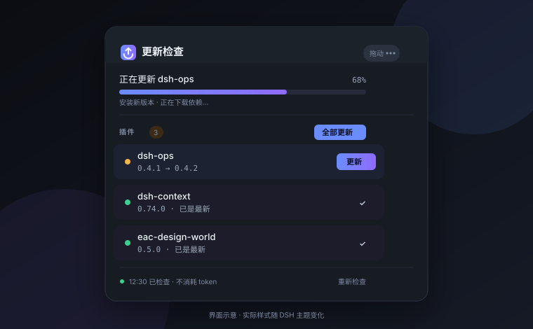

# dsh-plugin-updater

[](https://github.com/TT10-24/dsh-plugin-updater/actions/workflows/check.yml)
[](https://tt10-24.github.io/dsh-plugin-updater/)
[](LICENSE)

**DSH NEXT 的插件更新管家：插件版本、数据目录与内核，一次检查完，零 token 消耗。**

打开 DSH NEXT 时，它会静默检查你安装的插件和内置内核；有更新时，侧边栏旁会出现一个可拖动的面板。你可以单个更新、一键全部更新，也可以把插件、工作区和对话迁移到你选择的文件夹。全程不调用模型、不产生 agent 轮次、不消耗 token。

[**在线介绍页**](https://tt10-24.github.io/dsh-plugin-updater/) · [安装](#安装) · [使用](#使用) · [数据迁移](#dsh-next-数据目录迁移) · [常见问题](#常见问题)



---

## 你会得到什么

- **只面向 DSH NEXT**
  - 0.3.5 起移除了 DSH Desktop 的版本检查、桌面端更新、安装器交接和产品线迁移卡片。
  - 面板显示当前 DSH NEXT 版本与数据目录；DSH NEXT 自身负责应用更新。
- **插件检查与更新**
  - 读取你的 profile 与实时 bundle 列表，对比 npm registry。
  - 单个更新或一键全部更新；已完成的行立即消失。
  - DSH NEXT 拒绝热卸载的宿主插件会自动改为覆盖安装，并提示重启后生效。
- **数据目录迁移**
  - 把 DSH NEXT 指向你选择的文件夹。
  - 可以只切换指针，也可以复制插件、工作区、对话与存储后再切换。
  - 源目录不会被删除；指针只在复制成功后写入，失败会清理目标目录。
- **可拖动面板**
  - 拖动标题栏移动、双击复位、记住位置、`Esc` 关闭。
  - 点标题栏右侧的 **⋯** 调整宽度、最大高度、强调色、背景和不透明度。
- **零 token**：检查只是普通 HTTPS 请求；更新交给 DSH 自己的插件管理器与 pnpm。

## 安装

### 从 GitHub 安装（推荐）

打开 DSH NEXT 的 **设置 → 插件 → 添加插件**，填入：

```
github:TT10-24/dsh-plugin-updater
```

或者在终端里：

```bash
dsh plugin --profile desktop add github:TT10-24/dsh-plugin-updater
```

固定到某个版本：

```bash
dsh plugin --profile desktop add github:TT10-24/dsh-plugin-updater#v0.3.5
```

安装完成后重启 DSH NEXT。插件会出现在侧边栏底部（设置按钮旁），显示「查看更新」。

### 从本地目录安装

如果你在改代码，可以链接本地目录：

```bash
dsh plugin --profile desktop add link:"F:/path/to/dsh-plugin-updater"
```

## 使用

1. DSH NEXT 启动后会静默检查；有更新时侧边栏出现数量徽标。
2. 点「查看更新」打开面板。
3. 单个插件点「更新」；多个插件点「全部更新 (N)」。
4. 面板顶部会显示实时进度条和 pnpm 日志末行。
5. 更新成功的插件立即消失；如果需要重启，用 DSH NEXT 标题栏的重启。
6. 点面板右上角的 **⋯** 打开面板设置：调整宽度、最大高度、强调色、背景和不透明度。
7. 面板可以拖到任意位置，位置会被记住；双击标题栏复位。

> 更新已安装插件后，DSH NEXT 需要重启才能加载新的代码或新增组件行。这是 DSH 插件替换机制的限制，不是插件本身的问题。

## 面板设置

点标题栏右侧的 **⋯** 打开设置页，所有改动即时生效：

- **宽度** 320–560px，**最大高度** 380–820px；内容超出时在面板内部滚动。
- **强调色** 内置靛蓝、翠绿、琥珀、玫红、青蓝五套，也可以点最右侧的彩色圆点自选颜色；它会影响 Logo、主按钮、进度条和运行状态点。
- **背景** 内置深海军蓝、石墨灰、梅子紫、森林绿四套深色表面，不会跟随浅色主题变白。
- **不透明度** 72%–100%，适合把面板压在编辑器或网页上。
- **恢复默认** / **复位位置** 随时回到初始大小与侧边栏旁的默认位置。

设置保存在浏览器本地（`dsh-plugin-updater:panel-appearance`），不会上传，也不会消耗 token。

## DSH NEXT 数据目录迁移

DSH NEXT 默认使用 `~/.dsh`，只读取自己的位置文件。面板的 **DSH NEXT** 区域会显示当前版本和数据目录；点 **迁移数据目录**：

1. **当前数据目录** 是你现在正在使用的文件夹。
2. **目标文件夹** 可以手动输入绝对路径，或点 **浏览…** 使用 Windows 原生文件夹选择器。
3. **只切换指针**：要求目标文件夹已经有 DSH 数据（`profiles` / `sessions` / `storages`），适合数据已经在另一块盘的情况。
4. **同时复制现有数据**：目标文件夹必须不存在；插件会复制 `profiles`、`sessions`、`storages` 和根目录配置，再写入指针。复制包含插件包，可能需要几分钟。
5. 完成后点 DSH NEXT 标题栏的 **重启**；面板也会显示需要重启。

安全规则：

- 源目录永远不会被删除。
- 指针文件（`desktop-next-location.json` / `desktop-next-last-home.json`）在写入前会备份为 `.bak-时间戳`。
- 复制失败时删除本次创建的目标目录，不写指针。
- 目标文件夹不能是当前数据目录的父目录、子目录或同一个目录。
- 迁移记录与恢复脚本写在 `<DSH_HOME>/plugin-updater/data-home.json` 和 `restore-data-home.ps1`。

> 复制期间 DSH NEXT 仍在运行，当前会话最后几条消息可能尚未落盘；重要对话建议先结束当前任务再迁移。复制完成后以新目录启动，原目录仍可作为备份。

## 配置

在你的 profile 的 `cordis.patch.yml` 里覆盖本插件的行配置：

```yaml
- id: plugin-updater
  name: dsh-plugin-updater
  config:
    # 自定义 registry（默认 https://registry.npmjs.org）
    registry: https://registry.npmmirror.com
    autoCheck: true          # 是否自动检查
    checkOnBoot: true        # 启动后 1.5s 自动检查
    checkEngine: true        # 是否检查内核
    verbose: false           # Host 日志
```

修改后重启 DSH NEXT 生效。

## 忽略某个版本

不想升级某个插件、或者插件做了不兼容的大改时，可以只忽略“这一次”的版本：

- 每个可更新插件行都有 **忽略**。
- 只忽略当前最新版本；上游发布更新的版本后会重新提示。
- 已忽略的版本会留在 **已忽略** 区域，随时可以 **取消忽略**。
- 记录在 `<DSH_HOME>/plugin-updater/ignored.json`，只在本机，不发送。

## 常见问题

**会消耗 token 吗？**

不会。检查只请求 npm registry；更新调用 DSH 插件管理器与 pnpm。没有 LLM、没有 agent、没有 subagent。

**为什么更新完要重启？**

替换已安装插件的代码后，运行中的 DSH NEXT 仍持有旧模块；新增的组件行也要重启后才会进入运行树。面板检测到 `restart-required` 时会提示重启。

**点「更新」会发生什么？**

插件先尝试卸载旧版本，再安装目标版本。如果安装失败，它会自动恢复旧版本，并把原因显示在对应插件行下方。DSH 的 `installBundle` 本身是“新增插件”语义，直接安装已存在的包会被拒绝，所以默认走 remove + install。

在 DSH NEXT 中，正在运行的宿主插件可能被拒绝热卸载（`bundle-in-use`）或要求重启（`stop-profile`）。0.3.5 起遇到这两种情况会自动切换为覆盖安装：先把该依赖暂时从 profile 清单中隐藏，让插件管理器完成 pnpm 安装与重建，再恢复依赖并把插件重新选中。成功后提示重启，失败则回滚到原版本。

**为什么没有「更新 DSH NEXT」按钮了？**

0.3.5 起移除了 DSH Desktop 的更新交接；DSH NEXT 通过自己的设置页更新。插件只报告当前版本和数据目录，避免把已过时的桌面端版本服务和安装器流程继续堆在代码里。

**只切换指针和复制数据怎么选？**

数据已经在目标盘（例如手动移动过）时，选「只切换指针」，最快且不动文件。目标是一个全新文件夹时，勾选「同时复制现有数据」；复制完成后再写指针。

**迁移会复制什么？**

`profiles`（插件配置与插件包）、`sessions`（对话）、`storages`（存储）和根目录的凭据/偏好文件。`logs`、`electron-user-data`、`recovery` 不复制。

**某个插件要求批准 pnpm 构建脚本怎么办？**

安装会失败并恢复旧版本，面板会显示待批准的构建脚本。你可以在插件页手动批准后重试。

**怎么固定版本或回滚？**

安装时用 `#v0.3.5` 固定 tag；回滚就重新安装旧 tag，然后重启 DSH NEXT。

## 兼容性与限制

- **只支持 DSH NEXT**：0.3.5 起不再检测或更新 DSH Desktop。
- **插件更新**：优先使用 DSH 官方的 remove → install 路径；遇到 `bundle-in-use` / `stop-profile` 时自动覆盖安装并提示重启，失败会恢复旧版本、恢复 bundle 选中状态。
- **需要重启**：替换已安装插件或切换数据目录后，必须重启 DSH NEXT。
- **数据复制**：复制 `profiles` 会包含 `node_modules`，体积可能较大；迁移期间不要关闭 DSH NEXT。
- **文件夹选择器**：Windows 使用 PowerShell 的原生对话框；其他平台或选择器不可用时，可以直接输入绝对路径。
- **自动适配**：`pluginManager`、`profileContext`、`desktopRuntime` 都是可探测服务；缺失只会降级对应能力。

## 隐私与网络

- 读取：你的 profile 的 `package.json`、已安装包的版本号、DSH NEXT 数据目录指针，以及 `ignored.json`（都只在本地比较，不发送）。
- 请求：npm registry（默认 `registry.npmjs.org`）的包版本。
- 复制：只在你确认迁移时读写本机文件夹；不发送任何文件内容。
- 不调用：LLM、agent 工具、subagent。

## 项目文档

- [架构说明](docs/ARCHITECTURE.md)：Host/Client 分工、插件更新、数据迁移与进度事件。
- [开发历程](docs/BUILD-LOG.md)：从 0.1.0 到 0.3.5 的真实问题与修复记录。
- [贡献指南](CONTRIBUTING.md)：本地开发、检查与 PR 约定。

## 参与贡献

如果你发现 bug 或有新想法，欢迎开 [Issue](https://github.com/TT10-24/dsh-plugin-updater/issues)。提交代码前请先看 [CONTRIBUTING.md](CONTRIBUTING.md)，并确保以下检查通过：

```bash
node .check/locale-check.mjs ./client.js
node .check/render-check.mjs ./client.js
node .check/drag-check.mjs ./client.js
```

## English

A zero-token update checker for DSH NEXT (DeepSeek Harness). It checks installed plugins and the bundled core on launch, then opens a draggable panel for one-click updates. The same panel can migrate the DSH NEXT data folder — plugins, workspaces and conversations — to a folder you choose.

Click **⋯** in the panel header to change width, maximum height, accent color, surface and opacity; the choice is remembered locally. DSH Desktop is no longer supported: DSH NEXT updates itself, and this plugin only reports the running version and manages the data folder.

Install:

```bash
dsh plugin --profile desktop add github:TT10-24/dsh-plugin-updater
```

Read the [online page](https://tt10-24.github.io/dsh-plugin-updater/) or the [architecture notes](docs/ARCHITECTURE.md) for details.

## License

MIT
